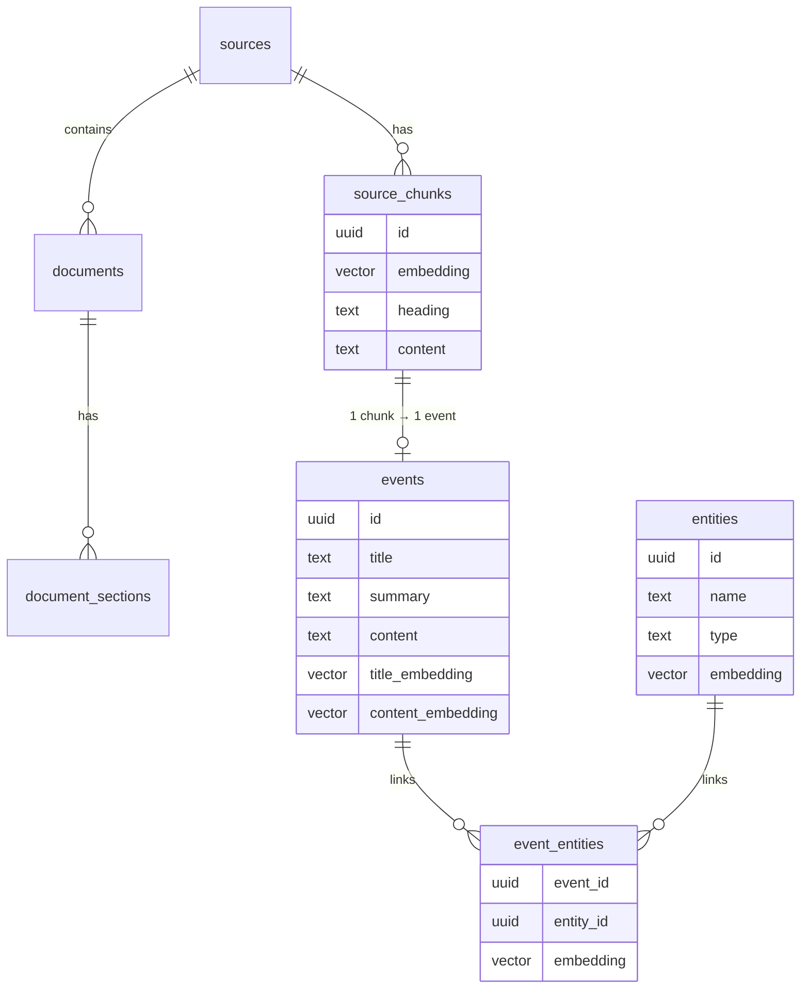
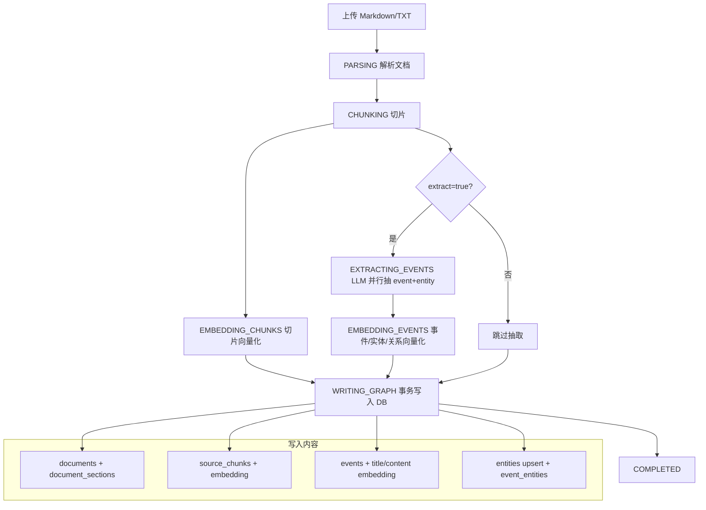
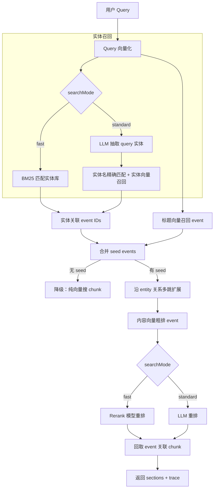
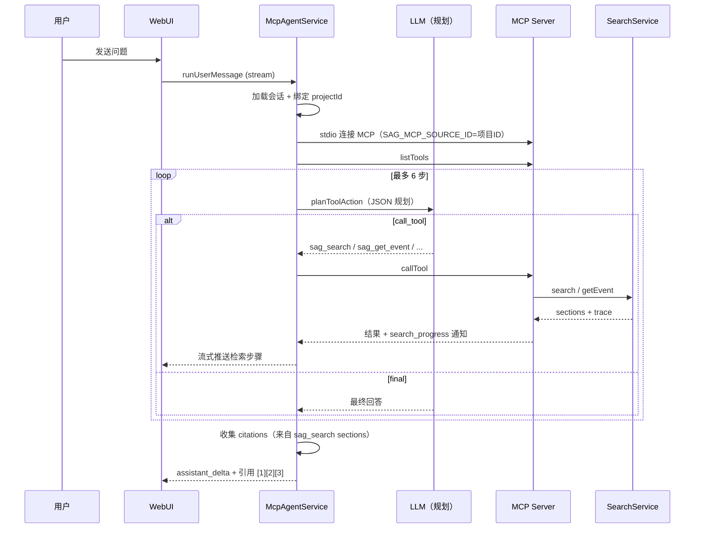
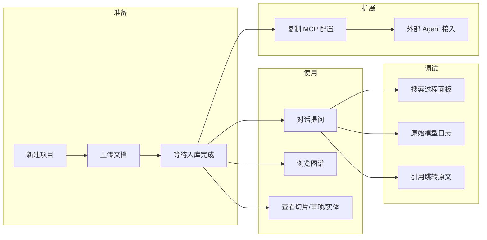

# SAG 项目特色功能流程分析笔记

> 基于源码梳理，聚焦 SAG 区别于普通 RAG 的核心能力。

---

## 1. 项目定位与核心差异

SAG（Structured Agentic Graph）不是「向量库 + 相似度检索」的简单 RAG，而是用轻量结构重组文档知识：

```text
chunk  →  event（事项，保留完整语义）
chunk  →  entities（实体，负责索引与关系扩展）
event  ↔  entities（通过 event_entities 关联）
```

**与普通 RAG 的关键区别：**

| 维度 | 普通向量 RAG | SAG |
|------|-------------|-----|
| 索引单元 | chunk 向量 | event + entity 双层索引 |
| 召回路径 | 单跳向量相似 | 实体命中 → 关联 event → 多跳扩展 |
| 语义载体 | 原始切片 | LLM 抽取的完整「事项」 |
| 关系能力 | 无 / 重型 KG | 轻量 event-entity 图，SQL 多跳查询 |
| 可观测性 | 黑盒 | 完整 SearchTrace + 模型调用日志 |

---

## 2. 数据模型速览



**入库后的三层资产：**

1. **切片（chunk）**：原文块 + 向量，用于降级召回和引用展示
2. **事项（event）**：每个 chunk 经 LLM 抽取 1 个完整语义单元，带 title/summary/content 双向量
3. **实体（entity）**：从 event 中抽取，去重 upsert，通过 `event_entities` 挂到 event 上

---

## 3. 特色功能一：文档入库流水线

**入口：** `POST /ingest`、`POST /api/documents/upload`、`MCP sag_ingest_document`  
**核心服务：** `src/services/ingestion-service.ts`

### 3.1 整体流程



### 3.2 切片策略

`src/ingestion/chunking/markdown.ts` 支持两种模式：

- **heading_strict（默认）**：按 Markdown 标题层级切分，一个标题区块 = 一个 chunk
- **token**：按 token 窗口切分，支持 overlap，适合长段落无标题文档

### 3.3 事项抽取规则

`src/ingestion/extract/extractor.ts`：

- 每个 chunk 调用 LLM 抽取 event + entities
- **强制每个 chunk 最多保留 1 个 event**（`.slice(0, 1)`）
- 实体名称长度 > 1 才保留
- 实体按 `type + name` 去重后再批量 embedding

### 3.4 并发与进度

- 并发数由 `INGEST_CONCURRENCY` 控制（默认 5）
- 各阶段通过 `onProgress` 回调推送：`PARSING → CHUNKING → EMBEDDING_CHUNKS → EXTRACTING_EVENTS → EMBEDDING_EVENTS → WRITING_GRAPH → COMPLETED`
- WebUI 文档页可实时展示处理进度

### 3.5 关键代码锚点

| 步骤 | 文件 | 函数/逻辑 |
|------|------|-----------|
| 切片 | `ingestion/chunking/markdown.ts` | `chunkMarkdown()` |
| 抽 event | `ingestion/extract/extractor.ts` | `extractEventsFromChunk()` |
| 编排入库 | `services/ingestion-service.ts` | `ingestDocument()` → `prepareEvents()` |
| 写库 | `services/ingestion-service.ts` | 事务内写 chunks/events/entities |

---

## 4. 特色功能二：SAG 多路检索（核心）

**入口：** `POST /api/search`、`POST /api/search/stream`、`MCP sag_search`  
**核心服务：** `src/services/search-service.ts`

这是项目最核心的特色：**不是直接搜 chunk，而是先找 entity/event，再沿关系多跳扩展，最后重排回取原文。**

### 4.1 两种检索策略

```text
strategy=vector  →  纯向量搜 chunk（基线对照）
strategy=multi   →  SAG 多路检索（默认，论文方法）
```

### 4.2 两种检索模式（multi 策略下）

| 模式 | 实体识别 | 重排方式 | 特点 |
|------|---------|---------|------|
| **fast（极速）** | BM25/全文匹配实体库 | Rerank 模型（qwen3-rerank） | 无 LLM 抽实体、无 LLM 过滤，延迟低 |
| **standard（标准）** | LLM 抽取 query 实体 | LLM 精排候选 event | 精度更高，LLM 调用更多 |

默认由 `DEFAULT_SEARCH_MODE` 或 WebUI 全局设置决定。

### 4.3 multi 检索完整流程



### 4.4 多跳扩展（subStrategy）

`expandEvents()` 支持三种子策略：

| subStrategy | 行为 |
|-------------|------|
| `multi`（默认） | 固定 `maxHops` 跳：seed event → 新 entity → 新 event → … |
| `multi1` | 一阶扩展 + 动态扩展（两阶段 eventset） |
| `hopllm` | 一阶扩展后先粗排，再动态扩展（论文变体） |

扩展逻辑：`collectNewEntityIds()` 从当前 event 集合收集未访问 entity → `getEventIdsByEntityIds()` SQL 查关联 event → 迭代直到 hop 上限或无新节点。

### 4.5 降级路径

若 seed events 为空（实体和标题向量都没命中），自动 fallback 到 `vectorSearch()`，并在 trace 中记录 `fallbackReason`。

### 4.6 SearchTrace 结构

每次检索可返回完整 trace（`returnTrace: true`），包含：

```text
queryEntities        → 识别/匹配到的查询实体
recalledEntities     → 召回的实体列表
entityEventIds       → 实体关联的事件
queryEventIds        → 标题向量召回的事件
expandedEventIds     → 多跳扩展得到的事件
coarseRankedEventIds → 粗排后的事件
rerankedEventIds     → 最终重排选出的事件
timings              → 各步骤耗时（ms）
```

WebUI 对话页右侧面板实时展示这些步骤；流式接口 `/api/search/stream` 通过 SSE 推送 `SearchProgressEvent`。

### 4.7 关键代码锚点

| 步骤 | 函数 |
|------|------|
| 检索入口 | `SearchService.search()` |
| SAG 主流程 | `SearchService.multiSearch()` |
| 多跳扩展 | `SearchService.expandEvents()` / `expandFixedHops()` |
| 实体 BM25 | `searchEntitiesByText()` in repositories |
| 事件粗排 | `coarseRankEventsByContent()` in repositories |

---

## 5. 特色功能三：对话式检索（MCP Agent）

**入口：** WebUI 对话页 → `POST /api/mcp/sessions/:id/messages/stream`  
**核心服务：** `src/services/mcp-agent-service.ts`

对话不是直接调 search API，而是通过 **MCP 协议** 让 LLM Agent 自主决定何时检索、如何改写 query。

### 5.1 对话流程



### 5.2 Agent 规划要点

LLM 系统提示要求：

1. 分析用户真实信息需求，改写为 SAG 搜索 query
2. 优先调用 `sag_search`（strategy=multi，returnTrace=true）
3. MCP 已绑定项目，**禁止**传 sourceId/projectId
4. 基于检索证据回答，用 `[1][2]` 标注引用
5. 证据不足时可二次 refined search

### 5.3 引用机制

`sag_search` 返回的 `sections` 会被 `collectAnswerCitations()` 转为 citation 列表，写入 assistant message 的 `metadata.citations`，WebUI 点击 `[1]` 可跳转原文 chunk。

### 5.4 无 LLM Key 时的回退

未配置 `LLM_API_KEY` 时走 `runFallbackToolFlow()`：用正则规则判断意图，仍通过真实 MCP 客户端调用 `sag_search` / `sag_get_event`，方便本地调试界面。

---

## 6. 特色功能四：知识图谱可视化

**入口：** WebUI 图谱页 → `GET /api/projects/:projectId/graph`  
**数据层：** `getProjectGraph()` in `src/db/repositories.ts`

### 6.1 图谱构成

```text
节点类型：
  - Entity 节点（name, type, eventCount）
  - Event 节点（title, rank, entityIds）

边：
  - entity ── event（event_entities 表）
```

前端 `web/src/components/ProjectGraphFlow.tsx` 用 React Flow 渲染，支持拖动、缩放、展开邻居、双击看详情。

### 6.2 与检索的关系

图谱不是独立系统，而是入库时 event-entity 关系的 **可视化投影**。检索时的多跳扩展走的就是同一张关系网（SQL 查 `event_entities` → `events`）。

---

## 7. 特色功能五：可观测性与调试

### 7.1 搜索过程可视化

- 流式 SSE：`/api/search/stream` 推送每步 `SearchProgressEvent`
- MCP 对话：tool call 的 `onprogress` 回调解析 `sag_search_progress` 通知
- 右侧面板展示：步骤名、详情、耗时、中间 payload（实体列表、event 快照等）

### 7.2 模型调用原始日志

- `src/observability/model-call-log.ts` 记录 LLM / Embedding / Rerank 请求与响应
- MCP 进度通知中 pipe `sag_model_call_log` 到前端
- `GET /api/model-call-logs` 可查询；WebUI 浏览器端也有缓存查看

### 7.3 文档处理结果浏览

文档详情页可分页查看：

- 切片（chunks）+ embedding 状态
- 事项（events）+ title/summary/content
- 实体（entities）+ type/name
- 标题关键字搜索

---

## 8. 特色功能六：MCP 外部 Agent 接入

**启动：** `npm run mcp`（stdio）  
**核心：** `src/mcp/server.ts`

每个项目独立 MCP 配置，通过环境变量 `SAG_MCP_SOURCE_ID` 绑定项目，外部 Agent 无需传 projectId。

| 工具 | 作用 |
|------|------|
| `sag_ingest_document` | 导入文档并完成完整入库流水线 |
| `sag_search` | SAG 多路检索，返回 sections + trace |
| `sag_explain_search` | 只返回 trace（调试检索链路） |
| `sag_get_event` | 按 eventId 查事件详情 |

WebUI 对话页本质上是 **内置 MCP Client**，与外部 Cursor/Claude 等 Agent 使用同一套工具。

---

## 9. 端到端用户旅程



---

## 10. 源码阅读路线建议

按「理解深度递增」顺序：

1. `README-CN.md` — 产品能力概览
2. `src/types.ts` — SearchTrace、IngestInput 等核心类型
3. `src/services/ingestion-service.ts` — 入库流水线
4. `src/services/search-service.ts` — SAG 检索主逻辑
5. `src/db/repositories.ts` — SQL 召回与多跳查询
6. `src/services/mcp-agent-service.ts` — 对话 Agent 编排
7. `src/mcp/server.ts` — MCP 工具定义
8. `web/src/App.tsx` — 前端页面与交互

---

## 11. 一句话总结各特色功能

| 功能 | 一句话 |
|------|--------|
| 结构化入库 | chunk 不只存向量，还抽 event+entity 建轻量知识图 |
| SAG 多路检索 | 实体命中 → event 召回 → 关系多跳 → 重排 → 回取原文 |
| 极速/标准模式 | 同一套 SAG 骨架，在 LLM 参与程度上做速度/精度权衡 |
| 对话 Agent | LLM 通过 MCP 自主检索，带引用和完整 trace |
| 图谱可视化 | 入库关系的交互式投影，辅助理解文档结构 |
| 全链路可观测 | 每步检索、每次模型调用均可追踪调试 |
| MCP 接入 | 项目级工具化，内外 Agent 共用同一检索能力 |
